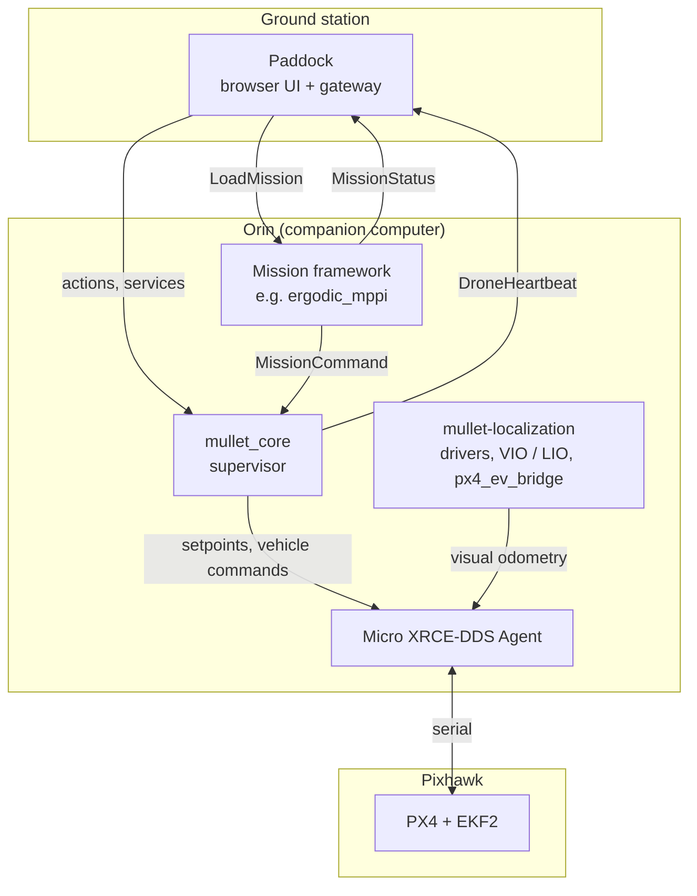

# Architecture

MULLET splits a drone's software into layers. Each layer may fail without taking away the control the layer below it holds. This page explains the layers, what each one may command, and how the parts find each other.

## Layers

| Layer | Runs on | Decides | Never does |
| --- | --- | --- | --- |
| PX4 | Pixhawk | attitude, motor output, state estimation (EKF2), failsafes | — |
| Supervisor (`mullet_core`) | Orin | when to arm, take off, hold, land; which setpoint PX4 gets; whether a command is allowed now | real-time control, or fighting PX4 or the pilot |
| Mission framework | Orin | the trajectory during a mission | publish to PX4 |
| Localization | Orin | the drone's pose from cameras or LiDAR, sent to EKF2 as external vision | command motion |
| Paddock | ground station | what the operator asks for | talk to PX4, or send raw setpoints |

PX4 is the hard real-time layer: it must meet its deadlines every cycle. The supervisor is soft real-time: it runs at 50 Hz, and a late cycle costs accuracy, not the vehicle, because PX4 keeps flying the last setpoint. A framework may stop at any time. When its commands go stale, the supervisor holds the drone in place.

## Who may publish to PX4

Only two nodes write to PX4's input topics (`/fmu/in/…`):

- `mullet_core` publishes `offboard_control_mode`, `trajectory_setpoint` and `vehicle_command`. These are the only topics that move the drone.
- `px4_ev_bridge` in mullet-localization publishes `vehicle_visual_odometry`, and only when its drone's profile fuses vision. It feeds the estimator and never commands motion.

Frameworks and Paddock never write `/fmu/in/…`. A framework asks for motion with `MissionCommand`. The supervisor checks that command, clamps it, and forwards it only while it is in `MISSION`.

## How the parts find each other

There is no configuration that lists the drones or frameworks. Everything is discovered from two topics on the shared ROS 2 domain.

- Every supervisor publishes `DroneHeartbeat` on `/mullet/heartbeat` at 10 Hz. A heartbeat carries the drone's state, position, its capability flags (`can_takeoff`, …) and the full names of its actions and services. Paddock lists a drone when its heartbeat appears, and drops it after 1 s without one.
- Every framework publishes `MissionStatus` on `/mullet/mission_status` at 2 Hz. It carries the framework's state, its preflight results, and the name of its `LoadMission` service.

The capability flags come from the same functions the supervisor uses to accept or refuse a command. A button that Paddock enables from a flag is therefore a command the supervisor will accept.

## Safety rules

!!! danger "The emergency stop is the RC kill switch"
    No software in MULLET replaces it. When PX4 reports a disarm, the supervisor aborts whatever it was doing and goes to `IDLE`.

- **Starting the stack is passive.** The supervisor never arms the drone or requests Offboard on its own. It acts only after an accepted **Takeoff**.
- **Land is the only way down.** It is accepted from any armed state, and once it is accepted it cannot be cancelled.
- **The pilot wins.** If the pilot switches PX4 out of Offboard, the supervisor stops commanding and holds. Position loss and other failsafes are PX4's to handle, so configure them in QGroundControl before the first flight.

The state machine itself is described on [Supervisor states](../on-field/fsm.md). The message types are listed on [mullet-interfaces](../stack/interfaces.md).
