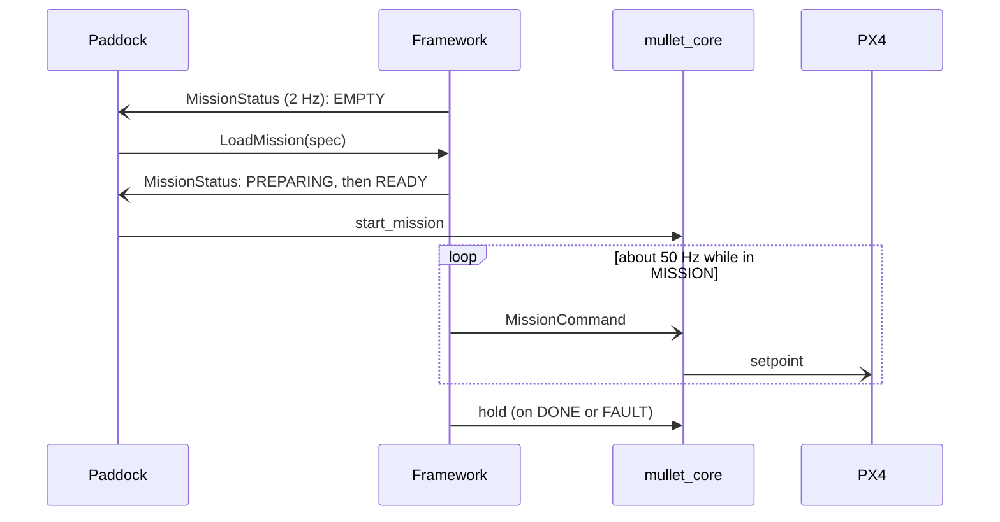

# Frameworks

A mission framework is a node that plans a mission and flies it through the supervisor. It runs only while the supervisor is in `MISSION`. Outside that state the supervisor ignores it. This page is the contract a new framework must follow. How to run one in the field is on [Running a framework](../on-field/frameworks.md).

## Rules

A framework must:

1. **Stream `MissionCommand` on `<namespace>/command`.** The supervisor forwards it to PX4 only in `MISSION`. After 0.25 s without a command it holds the drone in place, and after 2 s it leaves `MISSION`. The message's fields and command modes are described on [mullet-core](../stack/core.md#mission-command-modes).
2. **Never publish to `/fmu/in/…`.** Every way a framework can fail ends in the supervisor's own hold.
3. **Publish `MissionStatus` on `/mullet/mission_status` at 2 Hz.** Fill in `drone_id`, `framework`, `spec_schema`, `load_service_path` and `list_service_path`. Paddock discovers frameworks from this topic alone.
4. **Serve `LoadMission` and `ListMissions`.** Loading validates and prepares a mission but never starts it. The operator starts it with **Start mission**, which Paddock enables only when the framework reports `READY`.

A framework should also:

1. **Take every name from the heartbeat.** The node needs one parameter, `drone_id`. Its command topic, the hold service and the PX4 topics all come from that drone's `DroneHeartbeat`.
2. **Call the supervisor's `hold` service when the mission ends or faults**, so the drone stops in place instead of waiting 2 s for the stream timeout.

A spec is a JSON document whose `schema` key names its format and version, for example `ergodic/3`. Paddock greys out a framework whose `spec_schema` differs from the version its builder writes.

## Frameworks

| Framework | Spec schema | Repository |
| --- | --- | --- |
| [Ergodic MPPI](ergodic-mppi.md) | `ergodic/3` | [skymule-ai/ergodic_mppi](https://github.com/skymule-ai/ergodic_mppi) |

A new framework is a good project; see [Projects](../projects/index.md) for one that is planned.
