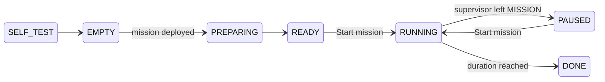

# Running a framework

A mission framework flies the drone only while the supervisor is in `MISSION`. The ergodic framework is the only one today. This page covers running it; what it computes is on [Ergodic MPPI](../frameworks/ergodic-mppi.md).

## Before you start

- The framework's image builds. The build runs the test suite, and a failing test produces no image.
- `docker/mission/.env` in the `ergodic_mppi` checkout matches the supervisor: `DRONE_ID=uav_0`, and `ROS_DOMAIN_ID` set to the drone's domain (the example file ships with 99, the aircraft value).
- The supervisor's velocity clamps are at least the spec's limits (see [Field parameters](fsm.md#field-parameters)).

## Start it on the Orin

The first time, clone the repository with its submodule:

```bash
ssh orin 'git clone --recursive git@github.com:skymule-ai/ergodic_mppi.git'
```

Then, every time, update it, build and start the container:

```bash
ssh orin 'cd ergodic_mppi && git pull --recurse-submodules && cd docker/mission && cp -n .env.example .env && docker compose up -d --build'
```

Set the Orin to its MAXN_SUPER power mode. Without it, the GPU misses the 16 ms step deadline the preflight checks, and every mission is refused.

```bash
ssh orin 'sudo nvpmodel -m 2'
```

Follow the log until it prints `EMPTY: self-test passed`:

```bash
ssh orin 'docker logs -f ergodic-mission'
```

## Status

The framework reports its status in Paddock's mission panel.



Any status can end in `FAULT`.

| Status | Meaning | What you do |
| --- | --- | --- |
| `SELF_TEST` | The framework is checking itself after boot. | Wait. |
| `EMPTY` | No mission is loaded. | Deploy one from the [Mission Builder](mission-builder.md). |
| `PREPARING` | The preflight is running, which takes about 20 s. | Wait, and watch the preflight lines. |
| `READY` | The mission is safe to start. | Press **Start mission**. |
| `RUNNING` | The framework streams commands at about 50 Hz. | Watch. Press **Hold** at any time. |
| `PAUSED` | The supervisor left `MISSION`. The framework keeps its memory of the area already covered. | Press **Start mission** to resume. |
| `DONE` | The mission reached its `duration_s`, and the drone holds. | Press **Return home** or **Land**. |
| `FAULT` | The framework refused the mission, or aborted it in flight after asking the supervisor to hold. | Read `detail` and the preflight lines. |

## Preflight lines

The panel shows each check as `<check>: ok` or `<check>: FAIL <reason>`.

| Check | FAIL means | Fix |
| --- | --- | --- |
| boot | A self-test failed. Every load is refused until it passes. | Rebuild the image. |
| `spec` | The spec is invalid, or a density peak is not in free space connected to the heaviest one. | Fix it in the Mission Builder. |
| `device` | The controller's 99th-percentile step time is above `deadline_ms` (16 ms) on both GPU and CPU. | Run `sudo nvpmodel -m 2` and check the NVIDIA container runtime. |
| `dry_run` | The simulated flight entered a safety margin, left the area, or went too fast. | Leave more room around obstacles, or use fewer or wider density blobs. |
| start | The position is stale, the EKF origin changed, the drone is above the ceiling, or it is outside the free space. | Fly into the area, under the ceiling. Reload the mission if the origin moved. |

## Automatic holds in flight

The framework asks the supervisor to hold, and goes to `FAULT`, when:

- PX4 moves its EKF origin. Reload the mission.
- The drone climbs above `max_altitude_m`.
- The plan for the next second comes within the drone's clearance of an obstacle.

If PX4's position is older than 0.1 s, the framework stops publishing, and the supervisor holds after 0.25 s.

## Bench test: Orin and Pixhawk in SIH

In SIH, the Pixhawk simulates the physics and sensors while its real firmware runs. The Orin talks to it over the real serial link, so the supervisor, the agent and the framework run exactly as they do in flight.

!!! warning "Props off"
    SIH does not spin the motors, but treat the bench as armed hardware.

1. In QGroundControl, save the parameters (*Parameters*, *Tools*, *Save to file*). Then set `SYS_AUTOSTART` to 1100, `SYS_HITL` to 2, and `SIH_LOC_LAT0`, `SIH_LOC_LON0` and `SIH_LOC_H0` to the lab's position. Reboot and wait for a 3D fix. If arming is refused because there is no RC, set `COM_RC_IN_MODE` to 4.
2. On the Orin, start the supervisor, then the framework, as above. Wait for `EMPTY: self-test passed`.
3. On the Orin, fly the experiment. The script records every command, flies the field scene (three density blobs and six pillars, three of them low enough to fly over), and writes `e2e.log`, `flight.npz`, the specs, `viewer.html` and `tracking.txt`. `--duration` is per mission, 60 s by default. The run passed if its output ends in `RESULT: PASS`.

    ```bash
    cd ~/ergodic_mppi
    tests/sitl/run_sih.sh ~/hil-flights/field-600s --modes trajectory_3d trajectory --duration 600
    ```

4. On the laptop, from an `ergodic_mppi` checkout, fetch the run. The script copies it to `~/sih-flights/field-600s` and opens `viewer.html`, which has a mission selector, a time slider, and the drone drawn along its heading.

    ```bash
    tests/sitl/fetch_sih.sh field-600s
    ```

5. Restore the saved parameters in QGroundControl and reboot.

## Simulator on a laptop

Start the simulated fleet from your mullet-sim checkout:

```bash
./run.sh --headless --config config/paddock.yaml --domain 42
```

Then fly a mission against `uav_1` with the end-to-end test:

```bash
docker run --rm --network host -e ROS_DOMAIN_ID=42 \
  ergodic-mission:latest python /workspace/tests/sitl/sitl_e2e.py --drone uav_1
```

A laptop GPU misses the 16 ms deadline, so the framework refuses missions. To test only the flow, start the node with `-p deadline_ms:=150.0`.
