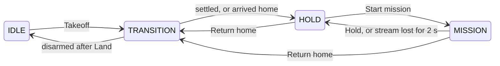

# Supervisor states

The supervisor, `mullet_core`, is always in one of four states. This page says what each state accepts, what ends it, and when PX4 overrides it. It is the only page that describes the state machine; other pages link here.



| State | Meaning |
| --- | --- |
| `IDLE` | On the ground, or not under the supervisor's control. |
| `TRANSITION` | A takeoff, landing or return home is running. The heartbeat's `active_action` says which: `takeoff`, `land` or `return_home`. |
| `HOLD` | Airborne, holding a fixed position. |
| `MISSION` | Airborne, following the commands a framework streams. |

**Land** is not drawn: it is accepted from every armed state and leads to `TRANSITION` with `active_action` `land`.

## What each state accepts

| State | Accepts | Ends when |
| --- | --- | --- |
| `IDLE` | **Takeoff**, if PX4 is disarmed, telemetry is valid, and the altitude is between 0.5 m and 10 m | a takeoff is accepted |
| `TRANSITION`, takeoff | **Land**, cancel | altitude and vertical speed (and the heading, if the goal set one) have been settled for 1 s; then `HOLD` |
| `TRANSITION`, return home | **Hold**, **Land**, cancel | the drone is within 0.5 m of home; then `HOLD` |
| `TRANSITION`, land | nothing: the landing is committed | PX4 reports disarmed; then `IDLE` |
| `HOLD` | **Start mission**, **Return home**, **Land** | one of those is accepted |
| `MISSION` | **Hold**, **Return home**, **Land** | one of those is accepted, or the command stream is lost for 2 s |

**Start mission** and **Return home** also require PX4 to be in Offboard. **Return home** additionally needs a home position, which the supervisor records at takeoff.

## Behaviour to know in the field

- **Starting the supervisor does nothing to the drone.** It never arms or requests Offboard until a **Takeoff** is accepted.
- **Cancelling a takeoff** before the supervisor has asked PX4 to arm returns to `IDLE`. After that point the drone lands, because PX4 may already be arming.
- **A stale command stream** is one with no new `MissionCommand` for 0.25 s (`command_timeout_s`). The drone then holds its position but stays in `MISSION`, and the heartbeat shows `command_stream_valid=false`. If the stream is still missing after 2 s (`command_loss_hold_s`), the supervisor leaves `MISSION` for `HOLD`.

<figure class="diagram">
--8<-- "docs/assets/figures/stale-stream.svg"
<figcaption>What happens when a framework stops publishing. The times are the shipped <code>command_timeout_s</code> and <code>command_loss_hold_s</code>.</figcaption>
</figure>

- **Altitude in a mission.** In the planar command modes the supervisor holds the altitude the drone had when it entered `MISSION`. In the 3D modes the framework commands the altitude too.
- **Landing** keeps sending PX4's land command until PX4 disarms, even after the **Land** action reports its 30 s timeout.
- **Return home** flies back above the takeoff point at the current altitude, at 2 m/s, and stops in `HOLD`. Land from there.

## When PX4 takes over

The supervisor checks these events first, on every cycle, while the drone flies under Offboard.

| Event | What the supervisor does |
| --- | --- |
| PX4 disarms (for example, the RC kill switch) | aborts every action and goes to `IDLE` |
| PX4 leaves Offboard (the pilot takes over, or a PX4 failsafe) | aborts every action and goes to a passive `HOLD`: it keeps updating its hold target to the current position, so switching back to Offboard holds in place |

The supervisor never fights PX4. Position loss and other failsafes are PX4's job, so set them up in QGroundControl before the first flight.

## Commanding the supervisor by hand

These commands use the aircraft's names (vehicle instance 0). A simulated drone puts its namespace in front, for example `/uav_1/takeoff`; see [Conventions](../concepts/conventions.md#vehicle-instances-and-names).

```bash
ros2 topic echo /mullet/heartbeat --once
ros2 action send_goal /takeoff mullet_interfaces/action/Takeoff "{altitude_m: 2.0, yaw_rad: 0.0, use_current_yaw: true}" --feedback
ros2 service call /start_mission std_srvs/srv/Trigger
ros2 service call /hold std_srvs/srv/Trigger
ros2 action send_goal /return_home mullet_interfaces/action/ReturnHome "{}" --feedback
ros2 action send_goal /land mullet_interfaces/action/Land "{}" --feedback
```

## Field parameters

The supervisor reads `mullet-core/config/mullet_core_params.yaml`. On the Orin, edit that file and then run `docker compose restart mullet_core` from `mullet-core/docker`. The values below are the ones that file ships with.

| Parameter | Shipped value | Change it when |
| --- | --- | --- |
| `min_takeoff_altitude_m`, `max_takeoff_altitude_m` | 0.5 m, 10.0 m | the site needs a different takeoff altitude |
| `max_vx_ned_mps`, `max_vy_ned_mps` | 2.0 m/s | a spec's `max_speed_mps` is higher; these clamps must never be lower |
| `max_vz_ned_mps` | 0.75 m/s | a spec's `max_vertical_speed_mps` is higher |
| `max_accel_ned_mps2` | 3.0 m/s² | you retune the airframe |
| `max_xy_position_lead_m`, `max_z_position_lead_m` | 1.0 m, 0.5 m | the trajectory modes lag or overshoot |
| `return_home_speed_mps` | 2.0 m/s | you tune a new airframe |
| `command_timeout_s` | 0.25 s | a framework publishes slower than about 8 Hz; better, fix the framework |
| `command_loss_hold_s` | 2.0 s | rarely: it bounds how long a crashed framework leaves the drone in `MISSION` |

The velocity clamps are a backstop, set about 0.5 m/s above what the frameworks fly. The full parameter list is in mullet-core's `docs/configuration.md`, whose defaults are the code's, not the shipped file's.
