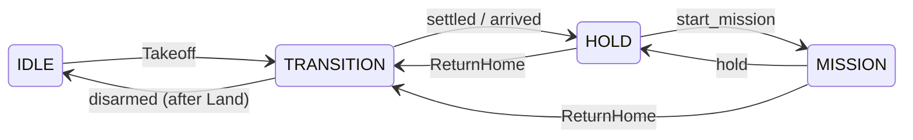

# FSM

The `mullet_core` supervisor has four states. PX4 overrides all of them. Details: [mullet-core](../stack/core.md).



`Land` goes from any armed state into `TRANSITION (land)`. The heartbeat's `active_action` tells you which transition is running: `takeoff`, `land` or `return_home`.

## What each state allows

| State | Accepts | Ends when |
| --- | --- | --- |
| `IDLE` | Takeoff (disarmed, telemetry valid, altitude in `[0.5, 10]` m) | Takeoff accepted |
| `TRANSITION` takeoff | Land, cancel | altitude, vertical speed and yaw settled for 1 s → `HOLD` |
| `TRANSITION` return home | Hold, Land, cancel | within 0.5 m of home → `HOLD` |
| `TRANSITION` land | nothing (committed) | PX4 disarmed → `IDLE` |
| `HOLD` | Start mission, Return home, Land | — |
| `MISSION` | Hold, Return home, Land | never ends on its own |

## Rules to remember on the field

- **Launch is passive.** Starting core never arms the drone or requests Offboard.
- **Cancelling a takeoff:** before the arm request it goes back to `IDLE`; after it, the drone **lands**.
- **Stale stream in `MISSION`.** If no `MissionCommand` arrives for 0.25 s, the drone holds its position and **stays in `MISSION`**. The heartbeat shows `command_stream_valid=false`.
- **Planar modes** hold the altitude the drone had when it entered `MISSION`. The **3D modes** command z.
- **Land retries** `NAV_LAND` until PX4 disarms, even after the 30 s action timeout.
- **Return home** flies at the current altitude, at 2 m/s, and stops in `HOLD`. You land from there.

## PX4 overrides

These are checked first on every tick while the drone is airborne under Offboard.

| Event | Core does |
| --- | --- |
| PX4 disarms (RC kill switch) | aborts all goals → `IDLE` |
| PX4 leaves Offboard (pilot takeover, failsafe) | aborts all goals → passive `HOLD`, re-latching the position every tick |

Core never fights PX4. Position loss and other failsafes belong to PX4, so configure them in QGC before the first flight.

## Names

| Setup | `vehicle_instance` | Actions / services | `drone_id` | PX4 topics |
| --- | --- | --- | --- | --- |
| Aircraft | `0` | `/takeoff`, `/start_mission`, … | `uav_0` | `/fmu/...` |
| SITL fleet | `N` | `/uav_N/takeoff`, … | `uav_N` | `/uav_N/fmu/...` |

## By hand (aircraft)

```bash
ros2 topic echo /mullet/heartbeat --once
ros2 action send_goal /takeoff mullet_interfaces/action/Takeoff "{altitude_m: 2.0, yaw_rad: 0.0, use_current_yaw: true}" --feedback
ros2 service call /start_mission std_srvs/srv/Trigger
ros2 service call /hold std_srvs/srv/Trigger
ros2 action send_goal /return_home mullet_interfaces/action/ReturnHome "{}" --feedback
ros2 action send_goal /land mullet_interfaces/action/Land "{}" --feedback
```

## Field parameters

Edit `mullet-core/config/mullet_core_params.yaml` on the Orin, then run `docker compose restart mullet_core`.

| Parameter | Default | Touch when |
| --- | --- | --- |
| `min/max_takeoff_altitude_m` | `0.5` / `10.0` | the site needs a different takeoff altitude |
| `max_vx_ned_mps`, `max_vy_ned_mps` | `1.0` | the spec's `max_speed_mps` is higher (these clamps must not be lower) |
| `max_vz_ned_mps` | `0.5` | the spec's `max_vertical_speed_mps` is higher |
| `max_accel_ned_mps2` | `3.0` | airframe tuning |
| `max_xy_position_lead_m`, `max_z_position_lead_m` | `1.0` / `0.5` | trajectory modes lag or overshoot |
| `return_home_speed_mps` | `2.0` | tuning for each airframe |
| `command_timeout_s` | `0.25` | the framework runs slower than about 8 Hz (better: fix the framework) |
