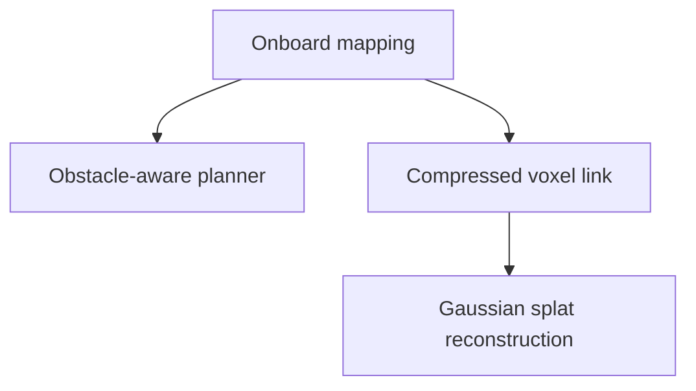

# Projects

These are pieces of work the stack needs and nobody owns yet. Each one is sized for a thesis or a focused development project. A brief says what the work is, where it plugs into the stack, and how to tell when it is done. It does not prescribe the method: choosing it is part of the project.

## How a project starts

A project has no repository until someone takes it. When you take one:

1. Put your name in the status table below, in the same pull request as anything else you change here.
2. Create the repository from the pattern the brief names, so it builds and deploys like the rest of the stack.
3. Keep the brief current. When the project ships, its repository gets a page under [Stack](../stack/index.md) or [Frameworks](../frameworks/index.md), and the brief links to it.

## Dependencies

The planner and the radio link both need the onboard map, so mapping comes first.

## Status

| Project | Built as | Needs | Status |
| --- | --- | --- | --- |
| [Onboard mapping](onboard-mapping.md) | a new image repository, like [mullet-lio](../stack/lio.md) | VIO or LIO odometry | open |
| [Obstacle-aware planner](obstacle-aware-planner.md) | a mission framework, like [Ergodic MPPI](../frameworks/ergodic-mppi.md) | onboard mapping | open |
| [Compressed voxel link](voxel-link.md) | an onboard encoder, a ground decoder, and a Paddock view | onboard mapping | open |
| [Gaussian splat reconstruction](gaussian-splat-reconstruction.md) | a ground-station pipeline and a Paddock view | recorded flights; the link for its extension | open |

## Brief template

Every brief uses these sections, in this order.

| Section | Content |
| --- | --- |
| Goal | What exists at the end, in two or three sentences. |
| Fits into the stack as | Which existing pattern it follows, and which components it touches. |
| Inputs and outputs | The topics or files it reads and writes, with their types. |
| Contract changes | What must change in mullet-interfaces, the supervisor or Paddock. |
| Milestones | Steps that each end in something testable. |
| Done when | The acceptance test, with a number where one makes sense. |
| Starting points | Existing code, data and literature to begin from. |
| Open questions | What the project has to decide. |
