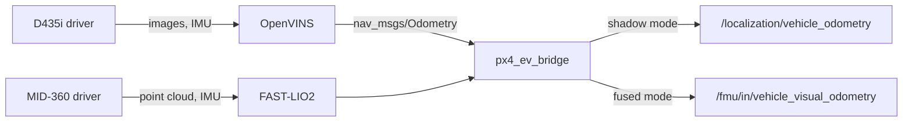
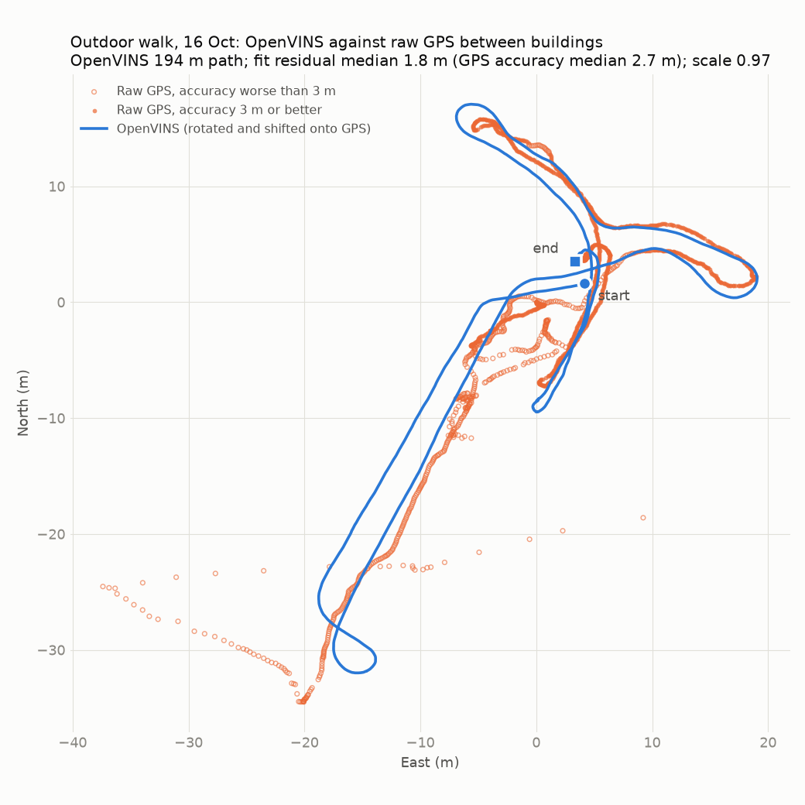

# mullet-localization

mullet-localization is one drone's localization, deployed as a single Compose project. It does not build the sensor drivers or the estimators: those come as images from [mullet-drivers](drivers.md), [mullet-vio](vio.md) and [mullet-lio](lio.md). This repository pins which of those images the drone runs, holds that drone's sensor configuration and calibration, and adds two things of its own: `px4_ev_bridge`, which passes the estimate to PX4's EKF2 as external vision, and a bag recorder.

Repository: [skymule-ai/mullet-localization](https://github.com/skymule-ai/mullet-localization)



Both estimators can run at once (`COMPOSE_PROFILES=openvins,fast-lio`) so they can be compared on the same flight, but the bridge forwards only one: the one named by `ODOMETRY_TOPIC`, with its extrinsic in `EV_BRIDGE_CONFIG`. The recorder and PX4 stay as they are.

## Interfaces

| Direction | Name | Type | Notes |
| --- | --- | --- | --- |
| publishes | `/uav0/d435i/…` | camera and IMU topics | from the D435i driver |
| publishes | `/livox/lidar`, `/livox/imu` | `livox_ros_driver2/CustomMsg`, `Imu` | from the MID-360 driver |
| publishes | `/uav0/fast_lio/odometry` | `nav_msgs/Odometry` | FAST-LIO2's estimate |
| publishes | `/uav0/openvins/odomimu` | `nav_msgs/Odometry` | OpenVINS's estimate |
| subscribes | `ODOMETRY_TOPIC` | `nav_msgs/Odometry` | the bridge's input |
| publishes | `/localization/vehicle_odometry` | `px4_msgs/VehicleOdometry` | shadow mode: recorded, not fused |
| publishes | `/fmu/in/vehicle_visual_odometry` | `px4_msgs/VehicleOdometry` | fused mode only (`PUBLISH_TO_PX4=true`) |
| serves | `ws://<drone-ip>:8765` | Foxglove WebSocket | with the `foxglove` profile |

The bridge is the only node besides the supervisor that writes to PX4, and it writes only this topic (see [Architecture](../concepts/architecture.md#who-may-publish-to-px4)). It sends the pose of `base_link` in a world FRD frame with an arbitrary heading, its velocity in the same frame, and variances taken from the estimator's covariance.

## Configuration

`.env` selects the stack and the images:

| Variable | Meaning |
| --- | --- |
| `ROS_DOMAIN_ID` | the drone's domain, 99 |
| `COMPOSE_PROFILES` | `openvins` (D435i, OpenVINS and the bridge), `fast-lio` (MID-360, PTP master, FAST-LIO2 and the bridge), or both; add `foxglove` as needed |
| `DRIVERS_TAG`, `VIO_TAG`, `LIO_TAG`, `LOCALIZATION_TAG` | immutable image tags |
| `ODOMETRY_TOPIC`, `EV_BRIDGE_CONFIG` | the estimator the bridge forwards, and its extrinsic file (`ev_bridge.yaml` OpenVINS, `ev_bridge_fast_lio.yaml` FAST-LIO2) |
| `LIVOX_IFACE` | the Orin interface wired to the MID-360, where the PTP master runs |
| `PUBLISH_TO_PX4` | `false` for shadow mode, `true` to send PX4 the estimate. Set it through a [mullet-px4](px4.md) profile, not by hand. |

`config/` holds what this drone flies with. It is mounted, so a change needs only `docker compose restart <service>`, and never during a flight. The defaults in mullet-drivers and mullet-vio are examples only.

| File | Content |
| --- | --- |
| `config/realsense/d435i.yaml` | infrared stereo at 848 × 480 and 30 Hz, projector off, IMU at 200 Hz |
| `config/livox/MID360s_config.json` | MID-360 at 192.168.1.104, host at 192.168.1.50 on a USB Ethernet adapter |
| `config/openvins/` | OpenVINS settings and the Kalibr camera–IMU calibration |
| `config/ev_bridge.yaml` | the pose of `base_link` in the estimator's body frame; identity until measured |

!!! warning "Keep the D435i projector off for VIO"
    The infrared projector casts a fixed dot pattern that moves with the camera. OpenVINS tracks the dots as if they were part of the scene, which causes drift indoors (4.5 % with it on against 1.4 % off on the 2026-10-16 office walk). The setting is `depth_module.emitter_enabled: 0`, and it must be the integer 0: `false` is rejected with only a warning, and the projector stays on. Check it with `ros2 param get /uav0/d435i depth_module.emitter_enabled`.

## Build and run

```bash
cp .env.example .env
docker compose pull && docker compose up -d
scripts/test-on-orin.sh                              # topic rates of the running stack
docker compose run -d --rm --name loc-record record  # record a bag into ~/flights/<UTC>_localization
docker kill -s INT loc-record                        # stop and close the bag
```

Pulling the images needs a GHCR login with `read:packages`. CI builds `ghcr.io/skymule-ai/mullet-localization` for ARM64 and runs `colcon test`.

Vision goes into service in three steps: a shadow flight that records but does not fuse, then fused with GPS on, then without GPS. Estimators are compared offline, by replaying the same bags through each one and scoring them against PX4's GPS estimate with `evo`.

<figure markdown>
{ width="560" }
<figcaption>An outdoor walk between buildings on 16 October 2026. Over a 194 m path, the median distance between OpenVINS and raw GPS is 1.8 m, against a median GPS accuracy of 2.7 m, and the fitted scale is 0.97.</figcaption>
</figure>

## Source of truth

The repository's `README.md`.
